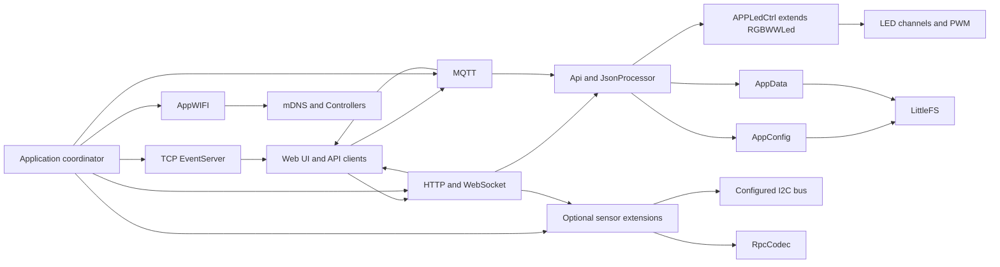

# Firmware Architecture

This document maps the firmware's main components, how requests and state move
between them, and the order in which the application is brought up. It focuses
on the runtime architecture; build and flashing instructions remain in the
[README](README.md).

## System Map

The firmware is a Sming application. `Application` is its composition root: it
owns the service objects and coordinates startup, shutdown, shared configuration
and cross-service events.



The principal responsibilities are:

| Component | Responsibility | Relationship to other components |
|---|---|---|
| `Application` | Owns application-wide services and sequences initialization, timers, and shutdown. | Connects configuration, networking, LED control, APIs, and event producers. |
| `AppConfig` / `AppData` | Generated ConfigDB models for device configuration and persistent user/application data. | Stored in LittleFS; accessed through scoped ConfigDB objects by the owning service. |
| `AppWIFI` | Configures station and first-run access-point behavior and handles Wi-Fi lifecycle callbacks. | Starts network-dependent services after connection; starts mDNS once an IP is assigned. |
| `ApplicationWebserver` | Serves the web application and HTTP API; owns the WebSocket endpoint. | Routes HTTP commands and JSON-RPC requests to `Api`; broadcasts live events. |
| `Api` / `JsonProcessor` | Implements data queries, command dispatch, and command validation. | Uses ConfigDB-backed JSON schemas and forwards control requests to `APPLedCtrl`. |
| `RpcCodec` | Renders API, event, and command payloads using generated ConfigDB types. | Shared by HTTP/WebSocket, MQTT, and TCP event publishing paths. |
| `APPLedCtrl` / `RGBWWLed` | Application-specific LED controller extending the RGBWW library's color conversion, per-channel output, and animation/transition engine. | Applies commands, drives PWM outputs, and publishes state changes and transition completion. |
| Sensor extensions | Optional INA219 current and AS7341 spectral drivers. | Owned and configured by `Application`; use the shared I2C bus and explicit HTTP handlers. INA219 readings also publish over subscribed WebSocket and MQTT; AS7341 measurements notify the requesting WebSocket client. |
| `AppMqttClient` | Publishes state/events and receives configured MQTT command topics. | Uses the shared command path for device commands and publishes through `RpcCodec`. |
| `EventServer` | Sends state-change events to persistent TCP clients. | Receives event publications from application and LED-control callbacks. |
| `Controllers` / `mdnsHandler` | Tracks known controllers and advertises/discovers network services. | Uses mDNS and `AppData`; supports peer awareness and controller synchronization. |
| `ApplicationOTA` / `WebappOta` | Manages firmware-image updates and web-application asset updates respectively. | Firmware OTA works with the boot/partition layer; webapp OTA stages files on LittleFS. |
| `TelemetryClient` / `UdpSyslogStream` | Sends periodic telemetry and diagnostic logs. | Uses network connectivity and configuration; syslog is enabled in applicable builds. |

## Request and State Flow

1. HTTP requests enter `ApplicationWebserver`. JSON-RPC requests arrive through
   its WebSocket handler. Both route device commands through `Api` and
   `JsonProcessor`.
2. MQTT command messages are decoded by `AppMqttClient` and forwarded through
   the same command-dispatch layer where applicable.
3. `APPLedCtrl` applies the operation to the selected `RGBWWLed`. On ESP32,
   the library's shared animation worker advances queues and updates PWM
   independently of the Sming event loop.
4. State changes are made available to clients over WebSocket, MQTT, or the TCP
   event server according to configuration. `transition_finished` is emitted
   when an animation step completes.
5. Persistent configuration and application data are separate ConfigDB stores
   backed by LittleFS. The transient JSON-RPC store is used to import or render
   one message at a time and is not application persistence.
6. When sensor extensions are included, `Application` configures them against
   the active I2C bus. `ApplicationWebserver` routes their config and reading
   endpoints, while `RpcCodec` provides the shared payload schemas for
   WebSocket/MQTT publication.

The API schemas live in the `.cfgdb` files. Generated types and `RpcCodec`
provide the JSON boundary, while command semantics and cross-field validation
remain in the API/processor layer.

## Bring-Up Sequence

The main sequence is implemented by `init()`, `onReady()`,
`Application::init()`, `Application::startServices()`, and the Wi-Fi callbacks.

1. Sming enters the firmware's `init()` function, initializes serial logging,
   and calls `onReady()`.
2. `onReady()` checks crash-loop state and calls `Application::init()`.
3. `Application::init()` checks the active boot/OTA partition, mounts the
   active filesystem, performs required boot-time OTA checks, and opens the
   ConfigDB configuration and data stores. Legacy webapp settings are migrated
   to their own store when present.
4. Configuration is checked, the controller registry is prepared, hardware
   pin configuration is selected, and `APPLedCtrl` initializes the LED/control
   engine. Buttons, HTTP routes, and Wi-Fi callbacks are then initialized.
5. `Application::startServices()` starts the RGBWW engine, enables the TCP
   event server when configured, and schedules the HTTP server startup after a
   short delay.
6. If no Wi-Fi credentials are configured, `AppWIFI` starts the setup access
   point. Otherwise it connects in station mode. On connection, network services
   such as MQTT (when enabled) and telemetry are started.
7. Once the station receives an IP address, the firmware starts mDNS and
   updates the local controller registry. A delayed webapp update check is also
   scheduled.

The access point is a recovery/setup path, not a prerequisite for normal
station-mode operation. Services that require a broker or reachable network
are conditional on their configuration and on network availability.

## Selected Board Profile

The webapp or Home Assistant copies the selected catalog entry into
`hardware.configuration.board_profile`, alongside matching `board_id`,
`board_revision` and `soc`. Firmware reads the selected profile through typed
ConfigDB accessors, without opening or parsing the catalog. The catalog is only
a selection resource served to configuration clients, not a runtime dependency.
Existing configurations without the snapshot require selecting and applying the
board again; firmware reports an explicit error rather than guessing a profile.

## Controller-Owned ESP32 PWM

`APPLedCtrl` owns the PWM resources in `ledctrl.cpp`: one populated bank on
ESP32-C3, or up to two speed-mode banks on classic ESP32. It centrally applies
frequency, resolution, timer selection, spread spectrum and phase shift.
RGBWWLed borrows channel bindings; colors and animation policy stay in the
library, and the existing shared HardwarePwm worker executes hardware fades.

All board pins allowing
`light.pwm` are initialized at zero, in profile order, including pins not
currently assigned to a light. Board capacity, SoC capabilities, reserved pins
and conflicts with configured inputs/I2C are checked before changing outputs.
A board must be selected before creating PWM lights. Unknown/mismatched profiles,
missing snapshots or allocation failures are explicit errors, not fallbacks to
arbitrary SoC GPIOs.

GPIO-to-bank/channel mapping is stable across light creation, deletion and
reordering. Deleting the last light leaves the board PWM banks alive. Unchanged
lights retain their instances, duties and animation queues when other lights
change. Removed/rebound views cancel only their assigned channels. AUTO phase
shift is distributed across the full physical bank, not each light's pin count.

Changing the selected board/profile/revision/SoC or PWM settings rebuilds the resources.
Preparation failures preserve the active setup. After detachment, activation
failures clear lights and PWM resources to a safe state, log the failure and
publish the actual empty light set; there is no automatic rollback.
Shutdown stops updates and invalidates reload callbacks, destroys light views,
then releases banks. `Application` invokes this idempotent shutdown before
member destruction because its light container otherwise dies first.

ESP8266/Host retain their existing output construction path. RGBWWLed 0.10.z
and Lightinator 5.0 pins are unaffected. The selected-profile persistence
and controller-owned PWM migration belong only to Lightinator 5.1 with
RGBWWLed 0.11.z; do not backport them to Lightinator 5.0 or RGBWWLed 0.10.z.
Software builds/native tests do not
establish physical fade cancellation on classic ESP32 or prove a flicker fix;
matched device workloads and waveform measurements remain necessary.

## ESP32 Animation Servicing (5.1+)

Each configured light opts into RGBWWLed's shared FreeRTOS animation worker.
There is one animation task for the controller, not one task or timer per
light. It waits against monotonic frame positions at a nominal 50 Hz and
advances over missed steps without replaying physical frames. Transition
targets are converted and corrected in RGBWWLed, then submitted as short
HardwarePwm microfades. The existing PWM worker still owns LEDC sequencing.
This changes transition output from whole-RAW-fade offloading to frame-level
interpolation, including for HSV transitions.

The Sming loop only receives coalesced state/completion notifications;
`APPLedCtrl::updateLed()` no longer renders ESP32 lights. Its calls to `show()`
consume finished flags, and clock reporting consumes the worker's logical
step counts (including skipped frames). Master-clock steering updates the
library service intervals in microseconds. A periodic firmware clock remains
only when no lights are configured, preserving clock-master operation on an
empty controller.

Commands and rendering share the library mutex. Color correction updates use
`RGBWWLed::Guard`; state getters return value snapshots. Reload stops and
detaches services before changing light bindings or PWM banks, then registers
the active lights again. Shutdown detaches services before destroying lights.
The animation task remains parked for reuse after the last detachment.
Networking and ConfigDB work stay outside the animation task and mutex.
ESP8266/Host retain cooperative servicing.

### Dual-core execution on classic ESP32

Classic ESP32 builds select `sdkconfig.dualcore` and `LED_WORKER_CORE=1` by
default. This enables both FreeRTOS cores while keeping
Sming and the application event loop serial on core 0. It is not a multicore
Sming port: only the isolated animation and hardware-PWM workers move to core 1.

| Execution context | Core | Responsibility |
| --- | --- | --- |
| Sming/TCP-IP (`tiT`) | 0 | Commands, ConfigDB, state serialization, network delivery and application callbacks |
| Wi-Fi, main task and FreeRTOS timer task | 0 | Existing network/startup/timer work |
| RGBWWLed (`rgbww-led`) | 1 | Shared monotonic animation scheduling, color conversion/correction and microfade submission |
| HardwarePwm (`pwm-worker`) | 1 | LEDC fade sequencing and hardware-completion processing |
| FreeRTOS idle and IPC tasks | Both | Per-core scheduling and SDK cross-core coordination |

The animation worker has a 6144-byte stack and priority `tskIDLE_PRIORITY + 1`;
the PWM worker has a 4096-byte stack and priority `tskIDLE_PRIORITY + 2`.
These are controller-wide workers, not per-light tasks. Moving the workers
does not move already-registered LEDC interrupts: in the tested configuration,
the fade ISR remains on the core where the driver was initialized, core 0.

The command/output path is:

1. A command enters on the Sming thread and updates animation state under the
   shared recursive `RGBWWLed::Guard` mutex.
2. The core-1 animation worker services the lights at nominal 20 ms frame
   positions, catches up logical time after missed frames, and submits corrected
   PWM microfades through the existing synchronized HardwarePwm interface.
3. LEDC runs the physical fade; completion interrupts wake the PWM worker.
4. State/completion notifications are coalesced back onto the Sming queue.
   Application callbacks run on core 0, outside the animation mutex.

Commands, snapshots, color correction, attachment and detachment must use the
same library synchronization as rendering. Light/container lifetime changes
remain on the Sming thread, with services detached before views or banks are
destroyed. Core-1 workers must not directly execute networking, ConfigDB or
application callbacks. The cross-core boundary is synchronized LED state,
HardwarePwm handoff and queued notifications, not general parallel application
execution.

#### SDK and framework requirements

`LED_WORKER_CORE=1` selects worker affinity through `RGBWW_SERVICE_CORE` and
`HWPWM_SERVICE_CORE`; it does not enable the second core by itself. The SDK must
be built with:

```text
CONFIG_FREERTOS_UNICORE=n
CONFIG_ESP_MAIN_TASK_AFFINITY_CPU0=y
CONFIG_LWIP_TCPIP_TASK_AFFINITY_CPU0=y
CONFIG_ESP_WIFI_TASK_PINNED_TO_CORE_0=y
```

The worker core must be less than `portNUM_PROCESSORS`, enforced at compile
time. Setting `LED_WORKER_CORE=` explicitly preserves unpinned task creation;
leaving it unset selects core 1 on classic ESP32. ESP8266
and single-core ESP32-C3 do not gain a second execution core.

The experiment uses an isolated Sming/SDK build rather than modifying the
shared installed framework. The firmware carries two required patches in
`docker/patches/`, applied by `docker/Dockerfile` after initializing the PWM
submodule and before building framework samples:

- `Esp32HardwarePwm/src/FadeWorker.cpp` supports `HWPWM_SERVICE_CORE` and pinned
  PWM-worker creation.
- The ESP32 dispatcher in `esp32/src/tasks.cpp` protects its coalesced wake flag
  with a dedicated cross-core `portMUX`. A failed TCP/IP mailbox kick
  (`ERR_MEM`) clears the flag so a subsequent post can retry; the flag is not
  synchronization-safe merely because it is volatile.

Both patches are always applied to containers built from this repository.
They are not committed or pushed to either framework fork. `git apply --check`
must pass for both before either is applied; an incompatible or already-patched
base fails the container build instead of silently skipping a patch. The
container's `SMING_COMMIT` still identifies its base source, not the locally
patched tree. Pin that build argument for reproducible images and retain the
firmware revision identifying the patches. PWM affinity remains opt-in when
`HWPWM_SERVICE_CORE` is set; the dispatcher synchronization is always active.

The firmware build flag alone is therefore not a complete dual-core port of
an unmodified framework. Build the SDK and affected framework/library objects
with matching configuration; changing affinity flags must not reuse stale
worker objects. ESP-IDF 5.2 startup supports the tested multicore application
with the existing unicore bootloader, so this classic-ESP32 experiment used
application-only OTA. This is a verified property of that configuration, not
a blanket bootloader-compatibility guarantee for other targets or SDKs.

For a fresh classic-ESP32 build using the patched container, select the
repository's dual-core SDK configuration explicitly:

```sh
make SMING_ARCH=Esp32 SMING_SOC=esp32 OUT_BASE=out/dualcore \
  SDK_CUSTOM_CONFIG=sdkconfig.dualcore LED_WORKER_CORE=1 \
  FADE_TIMING_DIAGNOSTICS=1 EVENT_MONITOR=0
```

An existing generated SDK configuration is not overridden by changing
`SDK_CUSTOM_CONFIG`. Use a dedicated container/build cache; regenerate its SDK
configuration with `sdk-config-clean` using the same architecture, SoC and
build flags before building. Do not clean a shared installed SDK. Core
selection is the classic-ESP32 default. Other targets retain `sdkconfig.esp32`
and no worker affinity unless explicitly selected; S3 remains compile-tested
only and is not enabled in the firmware matrix.

#### Capacity and timing boundaries

Core-1 execution removes animation/PWM worker CPU demand from Sming's core,
but does not prevent a slow Sming callback from blocking all other application
callbacks. State serialization and delivery still consume core-0 time and can
lag independently of physical output. SDK flash/cache operations can also
coordinate or stall both cores; core 1 is not an uninterrupted real-time island.

After fixing the diagnostic ISR path, ten paired measurement windows completed
on the dual-core test build. Under the measured all-channel fade workloads,
combined LED/PWM worker runtime was about 6.8-7.4% of one core, with about
55-63% idle capacity on core 1. LED Sming-callback wall occupancy still peaked
at 41-47 ms and enqueue-to-entry latency reached about 1.06 s. These are
workload-specific measurements, not reserved capacity or addressable-LED
deadline guarantees.

The large simultaneous-fade suite measures host-observed state timing, not
physical PWM edges, and did not capture synchronized traces explaining each
late observation. Do not attribute those observations solely to worker delays
or solely to network/queue delays. Addressable-LED support still needs a
hardware-assisted output design and its own worst-case timing validation.
Diagnostic builds reserve 48 KiB for the bounded trace buffer even when
recording is disabled; that memory cost is not intrinsic to dual-core operation.

## Optional Sensor Extensions

`Application` owns the optional INA219 and AS7341 drivers when those extensions
are included in the build. They share the active configured I2C bus; startup
and bus reconfiguration update sensor detection and measurement state. Their
extension-specific HTTP handlers are routed by `ApplicationWebserver`, while
generated payloads and notifications use the shared ConfigDB schemas and
`RpcCodec`.

`GET /extensions/<id>/config` is the current per-extension capability report:
the response identifies the extension and includes `available`. Clients must
match the reported ID before exposing extension-specific controls; availability
also reflects extension settings and the configured I2C bus, not just physical
presence. A missing endpoint means the extension is not included in that build.
Config POST handlers accept only writable settings. INA219 readings are sampled
periodically while enabled and available, with notifications to subscribed
WebSocket clients and MQTT. AS7341 measurements are started explicitly; results
are sent to the requesting WebSocket client or returned by HTTP polling. Both
readings expose validity and error state, which clients must respect. This is
an explicit pair of extension routes, not a general runtime extension registry.

## Opt-in fade timing measurements

ESP32 diagnostic builds may set `FADE_TIMING_DIAGNOSTICS=1` (default off).
Authenticated `POST /debug/fade-timing?light=N` starts a bounded 2048-entry RAM
capture; `GET /debug/fade-timing` stops it and exports CSV. No serial/syslog
output or allocation occurs in trace writes, including the hardware fade ISR.
The ISR trace path and its helpers must remain in IRAM, with data in internal
RAM: flash access can disable the cache while PWM interrupts are still enabled.
Flag reads use compiler atomics to avoid out-of-line standard-library calls;
verify the linked ISR call path when changing this instrumentation.
Overflow is counted and the probe rejects such captures. The endpoint is not
registered in ordinary builds.

Add `&service=1` to capture shared animation worker accounting instead of
per-channel hardware events. Events 20/21 bracket each service pass; event 21
contains mutex wait (`value`) and total pass time (`detail`), in microseconds.
For the selected light, event 22 records frame lateness and logical step count;
event 23 records render duration and step count (bit 31 marks completion).
Events 24/25/26 mark callback enqueue, dispatch entry and dispatch exit;
event 26 contains total dispatch duration. Event 27 marks rejected enqueue.
Worker/global events use `UINT32_MAX` as their light key. State and transport
events remain enabled, so worker delays can be separated from callback queue
and WebSocket delivery delays on the same monotonic clock. Service captures
do not measure hardware completion; keep them short and reject overflow.

`GET /debug/fade-timing?tasks=1` exports bounded FreeRTOS task runtime snapshots
when ESP-timer-based runtime statistics are enabled in the SDK. It does not
start or stop a trace. Difference two snapshots over a quiet measurement
window: task runtime delta divided by total-time delta is utilization of one
core; divide again by the reported core count for share of whole-chip CPU.
Subtract summed idle-task utilization from the core count to determine busy
capacity (including single-core configurations). Compare
steady outputs with fading to separate baseline service cost from fade cost;
task runtime includes interrupt time charged to that task, not just its code.
Worker CPU totals do not include state serialization on the TCP/IP task, so
measure that task's change as well. This is utilization, not deadline or
addressable-output-driver validation.

For paired CPU and dispatcher measurements, take a task snapshot with
`&account=1`, wait for the desired window, then take another with `&account=0`.
The second CSV header includes reset-on-read dispatcher batch totals/maxima,
sampled queue peak, enqueue failures, and aggregate LED service/mutex/dispatch
times. `queue_wait` measures LED callback enqueue-to-entry latency;
`led_dispatch` is wall time spent inside the LED Sming callback, during which
the dispatcher cannot execute another queued callback. `batch_max_us` covers
an entire Sming batch, not a single callback or queue residence time. Wall
times include preemption and must not be interpreted as CPU runtime or summed
with the CPU percentages. Accounting is bounded and does not emit per-frame
logs. Leave `EVENT_MONITOR=0` to avoid another consumer resetting these counters.

`tests/fade_timing_probe.py --host ADDRESS --light N --output DIRECTORY`
records command acceptance, hardware segment setup/ISR completion, application
state, serialization and websocket handoff. Client frame timestamps are taken
before and after JSON decoding. State records and send records are correlated
by trace ID and client TCP port, without extending normal light-state messages.
The probe restores the selected light and saves raw records alongside summaries.

Reported PWM duration spans first hardware setup to final completion ISR, not
an oscilloscope edge measurement. Software-only completion is labeled separately.
Host-minus-device spans quantify combined command transport and notification
overhead without assuming synchronized clocks (clock-rate drift remains).
Command request/response timestamps bound the host/device clock offset and
therefore bound websocket handoff-to-receive latency without assuming symmetric
network delays. This still includes TCP buffering, Wi-Fi and client scheduling;
the client timestamp is websocket application delivery, not a packet arrival time.
State progress for hardware fades is estimated: tolerance-based target detection
can precede real hardware completion, so timing overhead can be negative.

## WebSocket String Output: Possible Later Optimization

Investigate routing ordinary string notifications through the application's
incremental stream pump. Currently the string output queue flushes immediately;
the underlying WebSocket API already wraps strings in a memory stream, so a
String-to-Stream adapter alone does not defer the work.

A useful implementation would transfer ownership of the serialized payload
where possible, defer the initial pump (which currently runs synchronously),
and bound work per invocation. Preserve payload lifetime, per-connection FIFO
ordering, backpressure, disconnect handling and broadcast ownership semantics.
Measure logging, copies, framing and submission separately before changing the
path. Deferral redistributes work rather than eliminating it, does not reduce
ConfigDB/JSON generation cost, and does not guarantee a separate TCP/IP batch.
This is a candidate optimization, not a committed redesign or runtime change.

## Storage and Update Boundaries

- **Firmware image:** boot/partition management selects the running firmware
  and supports firmware OTA and rollback behavior.
- **Configuration:** `AppConfig` stores network, hardware, security, and runtime
  settings in the `app-config` ConfigDB area.
- **Application data:** `AppData` stores presets, scenes, groups, and controller
  records in the `app-data` ConfigDB area.
- **Web application:** static assets and staged webapp updates use LittleFS and
  the separate `WebappOta` path. Firmware and webapp update status/endpoints are
  therefore distinct.

For the public endpoint and command contracts, see the [HTTP API](README.md#http-api-reference),
[WebSocket API](README.md#websocket-api), and [MQTT integration](README.md#mqtt-integration)
sections in the README.

## Message Schema Layering

Outbound and inbound API messages are modelled by four ConfigDB schema files
that form a deliberate layered stack. The split exists so a single populated
payload object can be serialized either bare (HTTP) or wrapped in a JSON-RPC
envelope (WebSocket / TCP event server / MQTT) without redefining its shape.

| File | Layer | Role |
|---|---|---|
| [value-types.cfgdb](value-types.cfgdb) | scalars | Reusable constrained primitives (`string-value`, `raw-value`, `hue-value`, `error-code`, …). |
| [homeassistant.cfgdb](homeassistant.cfgdb) | Home Assistant | Home Assistant MQTT command, state, discovery, and info payload schemas. |
| [params.cfgdb](params.cfgdb) | payload | Transport-independent body objects. This is exactly what the HTTP interface sends and receives, and also what becomes the JSON-RPC `params`/`result`. |
| [jsonrpc.cfgdb](jsonrpc.cfgdb) | framing | A root `oneOf` of message bodies. The ConfigDB library emits the `{"jsonrpc":"2.0",…}` envelope and selects the `params`/`result`/`error` key from `Message::kind`; each member references the body shape it frames. |

### Two serialization entry points, one payload

- **HTTP** renders a [params.cfgdb](params.cfgdb) body object directly (bare,
  unframed).
- **WS / TCP / MQTT** render the same body wrapped by the
  [jsonrpc.cfgdb](jsonrpc.cfgdb) envelope.

`RpcCodec` (see the component table above) owns both paths so one producer
populates one payload object and either transport can render it.

### Authoring rule

Define a reusable transport-independent body once in [params.cfgdb](params.cfgdb)
`$defs` and reference it. Keep Home Assistant-specific MQTT schemas in
[homeassistant.cfgdb](homeassistant.cfgdb). Add a [jsonrpc.cfgdb](jsonrpc.cfgdb)
root member only when a body is actually sent over a framed transport; HTTP-only
bodies need no framing entry. Primitive constraints belong in
[value-types.cfgdb](value-types.cfgdb), never inlined.

The current schema inventory and generation process are documented in
[API_SCHEMA.md](API_SCHEMA.md). Historical migration and design proposals are
not part of the current runtime contract.

### Known deviations (cleanup backlog)

The current files violate the authoring rule in two ways; both are tracked here
so the layering intent stays legible until they are reconciled:

- **Bodies inlined in `jsonrpc.cfgdb` instead of referencing `params.cfgdb`.**
  The framing members `wifi_status`, `transition_finished`, `clock_slave_status`,
  `keep_alive`, `message_event`, `ota_status`, `webapp_ota_status`,
  `api_success`, `api_error`, `authenticate_result`, `subscription_result`,
  `rpc_error` and `error` define their object bodies inline rather than via
  `$ref` into [params.cfgdb](params.cfgdb).
- **Orphaned payload `$defs`.** [params.cfgdb](params.cfgdb) already carries
   `wifi-status-params`, `transition-finished-params`, `clock-slave-status-params`
   and `keep-alive-params`, which duplicate (or should back) those inline bodies
   but are currently referenced nowhere. [homeassistant.cfgdb](homeassistant.cfgdb)
   also carries the currently unused `ha-discovery-params` definition.
- **Conflicting `error` shapes.** [params.cfgdb](params.cfgdb) `error` is
  `{code, message, data}`; the [jsonrpc.cfgdb](jsonrpc.cfgdb) inline `error`
  wraps `{error: value-types/error-msg}`; and the inline `rpc_error` adds a
  `challenge` field. These need a single deliberate error body before they can
  be consolidated.

Reconciliation means moving each inline body into [params.cfgdb](params.cfgdb)
`$defs` (reusing the orphaned definitions where they already match) and reducing
the [jsonrpc.cfgdb](jsonrpc.cfgdb) members to `$ref`s.
